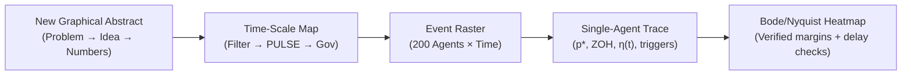

# Action Plan for Future Paper Improvement: Addressing SEGAN Reviewer Reports

This document compiles the complete feedback from both the first-pass and second-pass reviewer reports for the *Sustainable Energy, Grids and Networks* (SEGAN) submission. It establishes a prioritized, step-by-step roadmap to elevate the paper to a defensible, high-rigor contribution.

---

## 1. Executive Summary & Reviewer Risk Analysis

### The Acceptance Landscape
- **Editorial Desk-Rejection Risks**: Scope exclusions ("case study without methodological insights" and "converter control" exclusions) and reliance on a single-bus toy benchmark.
- **Reviewer Rejection Risks**: Numerical inconsistencies across configurations, questionable hand-derived stability margins, violated error bounds, and missing competitive baselines.

Both failure modes are resolvable by repositioning the paper as a **communication-aware control and delay-robustness methodology** paper with formal theorems, verified references, and benchmark validation on a canonical configuration.

---

## 2. Priority 1: Mandatory Blockers (Fix First)

| # | Action Item | Motivation & Technical Requirement |
|---|---|---|
| **B1** | **Recompute Frequency-Domain Analysis** | Recompute plant and open-loop crossover frequency $\omega_{\mathrm{gc}}$, phase margin $\mathrm{PM}$, and delay margin using `python-control` / `scipy.signal`. Hand checks revealed discrepancies with the reported values ($\omega_c = 1.25\,\text{rad/s}$ vs. $1.45\,\text{rad/s}$, $\mathrm{PM} = 68.2^\circ$ vs. $130^\circ$, and positive phase crossings). Empirically validate the delay margin by injecting delays of $0.5\times$, $1.0\times$, and $1.5\times$ the predicted margin in the dynamic simulation. |
| **B2** | **One Canonical Configuration for All Headline Numbers** | Define a single canonical configuration (the SoC-gated, heterogeneous fleet under realistic 1-cycle PLL filtering and noise) for every headline metric across the Abstract, Highlights, Introduction, Results, and Conclusions: nadir, RoCoF, per-rack energy throughput, preserved runtime, and message counts. Move unconstrained/idealized cases into clearly labeled ablation subsections. |
| **B3** | **Harmonize Message Reduction Percentages** | Reconcile divergent reduction figures ($63.6\%$, $66.7\%$, $68.6\%$, $68.2\text{--}78.7\%$) into one standard, rigorously defined metric over a fixed evaluation horizon (e.g., 30 s) with confidence intervals. |
| **B4** | **Re-derive or Restate Analytical Error Bound** | The existing bound predicts $|\Delta f_{\mathrm{err}}| \le 8.0\,\text{mHz}$, yet the observed deviation from continuous droop is $10.4\,\text{mHz}$. Fix Eq. 15–17 by integrating the dynamic Lipschitz continuity constant $L_p$ and re-deriving the bound through a dynamic input-to-state stability (ISS) framework rather than dividing by static steady-state gains. |
| **B5** | **Resolve Technical Inconsistencies & Symbol Clashes** | - Fix steady-state frequency ($59.857\,\text{Hz}$ calculated vs. $59.750\,\text{Hz}$ stated). - Remove "identical nadir" claims ($59.7209$ vs $59.7309\,\text{Hz}$ are distinct). - Fix "twentyfold" margin statement ($0.952\,\text{s} / 50\,\text{ms} \approx 19\times$). - Disambiguate symbol clash: rename threshold relaxation time constant $\tau_{\eta}$ (or $\tau_{\mathrm{relax}}$) and RoCoF filter constant $\tau_r$. - Reconcile Data Availability statements between review-stage and camera-ready repository access. |

---

## 3. Priority 2: Core Methodological & Theoretical Additions for SEGAN

### Positioning
Reposition the manuscript as a **control and ICT integration methodology** contribution:
> *Suggested Working Title:* **"Adaptive Event-Triggered Fast Frequency Support under Communication Impairments: Delay-Margin Analysis and Reserve-Constrained Design for Distributed Storage Fleets"**

### Theoretical Formulations
- **Theorem 1 (Zeno Exclusion):** Formally prove that the anti-Zeno dwell time $\delta = 1.5\,\text{ms}$ combined with the relaxing threshold $\eta_i(t)$ establishes a strictly positive lower bound on inter-event intervals $\tau_{\mathrm{event}} \ge \delta > 0$.
- **Theorem 2 (Stability Under Delay and Packet Drop):** Develop a Lyapunov–Krasovskii or small-gain / ISS stability proof for the coupled swing-governor loop with event-triggered zero-order-hold (ZOH), bounded latency $\tau_i \le \bar{\tau}$, and consecutive packet-drop limit $k_{\mathrm{drop}}$. This replaces the unconstrained linear phase margin estimate.
- **Proposition 3 (Analytical Message Count Bound):** Formulate a closed-form upper bound on the maximum number of generated events as a function of $\eta_r$, $\tau_{\eta}$, and contingency step magnitude $\Delta P_L$, providing a systematic design rule for parameter selection.
- **Actuator Saturation Handling:** Characterize the $[0, P_{\max}]$ unipolar discharge clipping using the circle criterion or describing function analysis.
- **Systematic Parameter Tuning:** Provide explicit design guidance and sensitivity surfaces for $(\eta_0, \eta_r, \tau_{\eta})$.

### Physical & Deployment Realism
- **Energy Sizing Sweep**: Contrast hyperscale UPS battery sizing ($1\text{--}5\,\text{min}$ commercial UPS backup vs. $30\,\text{min}$ storage packs) and sweep pack energy from $1\,\text{kWh}$ to $30\,\text{kWh}$ per rack.
- **FFR Speed vs. Vendor Realities**: Acknowledge that commercial grid-interactive UPS systems typically engage within $0.5\text{--}10\,\text{s}$, clearly articulating how sub-100 ms filtered sensing interfaces with existing converter controls.
- **SoC Floor Pareto Frontier**: Sweep the reserve floor $\mathrm{SoC}_{\min} \in [70\%, 75\%, 80\%, 85\%, 90\%]$, plotting nadir recovery against preserved server runtime.
- **Recharge Rebound**: Model post-contingency battery recharge dynamics to evaluate secondary frequency impacts.
- **Grid Export Clarification**: Formally specify whether UPS units operate in net-load reduction mode (curbing data center demand) or reverse-power grid export mode.

---

## 4. Priority 3: Evaluation, Baselines, and Benchmark Systems

1. **Comprehensive Baseline Suite**:
   - Compare against **send-on-delta with deadband**.
   - Compare against **periodic polling with deadband**.
   - Compare against **local droop/PD** with the identical SoC reserve gate.
   - Compare against **derivative-free UPS synthetic inertia** (e.g., PCIM Europe 2022).
2. **Benchmark Scaling**:
   - Migrate beyond the single-bus 300 MVA system to a multi-machine transmission benchmark (e.g., modified **IEEE 39-bus** network).
   - Replay real recorded PMU frequency event traces to validate against physical grid disturbances.
3. **Parametric Scaling**:
   - Sweep agent count $N \in [50, 200, 500, 2000]$ and fleet penetration relative to substation base ($1\%\text{--}10\%$).
4. **Stress Testing**:
   - Evaluate burst and correlated packet drop models (Markovian Gilbert–Elliott channels).
   - Simulate severe communication outages and delays approaching the analytical delay margin ($0.5\text{--}1.5\,\text{s}$).
5. **Operational Reliability Payoff**:
   - Quantify avoided Under-Frequency Load Shedding (UFLS) thresholds.
   - Report severe low-inertia cases ($H = 2.0\,\text{s}$, $8\%$ generation loss) with full distribution metrics.

---

## 5. Visualizations to Add or Redo

| Visual Asset | Description & Content | Strategic Purpose |
|---|---|---|
| **New Graphical Abstract** | Three concise panels: (1) Problem (frequency nadir and RoCoF excursion), (2) Method (adaptive time-relaxing event threshold), (3) Result (verified nadir, zero idle traffic, preserved backup). | Replaces duplicate Fig. 1 with an outcome-driven summary. |
| **Time-Scale Map** | Horizontal log-time axis ($1\,\text{ms} \to 30\,\text{s}$): sensor filter window, PULSE actuation, inertial window, reheat governor, and SoC reserve depletion. | Situates PULSE physically across power grid dynamical regimes. |
| **Event Raster** | 2D scatter plot ($200\,\text{agents} \times \text{time}$) displaying transmission impulses for Periodic, FETC, and PULSE. | Visually illustrates communication traffic pruning. |
| **Single-Agent Trace** | Synchronized time traces of $\eta_i(t)$, candidate power $p_i^\ast(t)$, ZOH output $p_i(t)$, and trigger impulses. | Explains the adaptive threshold relaxation mechanism. |
| **Bode / Nyquist with Margin Checks** | Verified Nyquist/Bode plots with annotated gain/phase margins, delay margin heatmap vs. $(K_d, \tau_f)$, and time-domain injected delay traces ($0.5\times, 1.0\times, 1.5\times$). | Provides irrefutable, verifiable proof of closed-loop stability. |
| **Comprehensive Pareto Frontier** | Nadir vs. message volume across all baselines (Send-on-Delta, Periodic, FETC, PULSE) with confidence intervals. | Replaces the 2-curve comparison with a complete benchmark. |
| **Stability Region in $(p_{\mathrm{loss}}, \tau)$ Plane** | Shaded stable/unstable operational regions with theoretical stability bounds overlaid. | Replaces uninformative overlapping loss traces. |
| **Fleet State Distribution** | Pre- and post-event SoC histograms, availability factor $a_i$, and runtime CDF curves annotated with Tier III/IV standards. | Proves reserve preservation across heterogeneous fleets. |
| **Physical Deployment Architecture** | Physical communication layout: Rack UPS $\to$ Smart PDU $\to$ Local Microgrid Controller $\to$ Substation Gateway with a stacked latency budget. | Grounds the communication network and payload in realistic facilities. |

---

## 6. Literature Overhaul & Verified Reference Roadmap

Organize the literature review into five distinct thematic gaps rather than an author-by-author list:
1. **Low-Inertia Frequency Containment from BESS**: Sizing, RoCoF impacts, and subsecond speed constraints.
2. **Data Centers & Industrial UPS as Distributed Grid Resources**: Real-world field trials and grid-interactive UPS hardware limits.
3. **Communication-Aware & Event-Triggered Frequency Control**: Network-constrained DER coordination.
4. **Delay Margins & Cyber-Physical Stability of Aggregated DERs**: Delay-dependent LFC and time-domain margins.
5. **State-of-Charge & Mission-Critical Reserve Protection**: Quarantining backup capacity for computing uptime.

### Candidate References to Integrate & Verify

| Topic Area | Reference / Citation Target | Strategic Function in Paper |
|---|---|---|
| **Data Center FFR** | *Fast Frequency Response Potential of Data Centers through Workload Modulation and UPS Coordination*, arXiv:2512.14128 | Closest direct comparator; evaluate and differentiate. |
| **Data Center FFR Scale** | Tao & Gadh, arXiv:2512.14136 | Large-scale loss benchmark comparison ($1.0\,\text{GW}$ loss). |
| **Industrial UPS Grid Service** | Paananen & Nasr (Eaton/Microsoft), *Grid-interactive data centers: enabling decarbonization and system stability* | Documents practical MW-scale data center UPS deployments. |
| **Market & Volume Realities** | Paananen (2022) thesis on grid-interactive UPS and FFR potential | Contextualizes commercial market volume and response timing. |
| **Derivative-Free Inertia** | *Frequency Control and Inertia Provision with UPS*, PCIM Europe 2022 | Benchmark baseline for derivative-free UPS inertia emulation. |
| **Event-Triggering + SoC** | Yu, Lu, Lai & Chai, arXiv:2103.05576 | Event-triggered, Zeno-free, SoC-aware DER coordination. |
| **ET + Delay + SoC** | Xue et al. (2023), *Adaptive event-triggered secondary frequency control with auxiliary storage* | Close conceptual peer; differentiate subsecond vs. secondary control. |
| **Delay Margins in LFC** | Yuan et al., *Front. Energy Res.* 9:771465 (2021) | Delay-dependent stability formulation for aggregator fleets. |
| **Analytical Delay Formulas** | Naveed et al., *EV aggregators in two-area LFC* | Analytical formulas for closed-loop delay margins. |
| **DER Latency in AGC** | Wang, Fang & Florita (NREL), *DER communication delay in AGC* | Co-simulation benchmark reporting multi-second delay margins. |
| **Resilient Aggregation** | Boyle et al., *IEEE Trans. Smart Grid* (2024) | Justification for fail-safe ZOH operation under packet drop. |
| **RoCoF & BESS Response Times** | Brogan et al. (2018), *Impact of BESS speed on RoCoF and nadir* | Grounding the 65 ms filtered rise time within empirical RoCoF windows. |
| **Grid Codes & Standards** | IEEE 2800-2022, IEEE 1547-2018, ENTSO-E FFR Requirements | Replacing misattributed literature citations for grid-code requirements. |

---

## 7. Submission Package & SEGAN Workflow

- **Cover Letter Strategy**:
  - Keep to 1 single-spaced, high-impact page.
  - Lead with the core methodological contribution: communication-aware adaptive event-triggered control under network latency, packet drop, and reserve constraints.
  - Directly align with SEGAN focus areas: *Control of Distributed Energy Storage*, *ICT Integration*, and *Cyber-Physical Modeling*.
  - Suggest 4–5 recognized expert reviewers (event-triggered control theory, frequency stability, data center energy systems) and state zero conflicts.
- **Editorial Screen Awareness**:
  - SEGAN first decision turnaround is approximately 6 days. The first page (Abstract, Title, Introduction opening) and cover letter carry the desk-screening decision.
