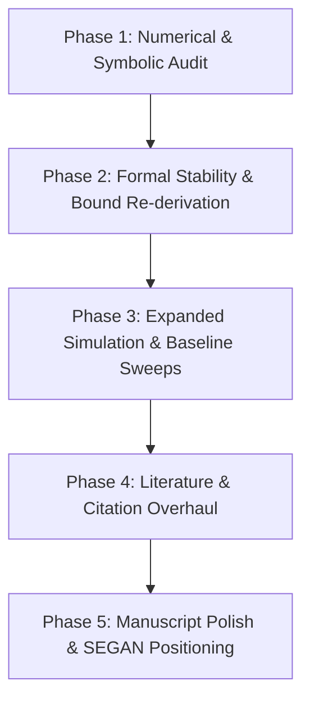

# Action Plan for Future Paper Improvement: Addressing SEGAN Reviewer Report

This document records the complete reviewer feedback from the *Sustainable Energy, Grids and Networks* (SEGAN) review report and outlines the concrete, step-by-step action plan to address every technical, numerical, and structural point in future revisions.

---

## 1. Summary of Reviewer Feedback

### Section 1: Tone, Style, and Perceived Automation
- **Journal-scope mirroring**: The Introduction bullets copied journal topic headings almost verbatim. Need to integrate journal scope naturally in one sentence rather than formulaic bullet points.
- **Pipeline meta-statements**: Remove statements referencing local pipeline artifacts (e.g., `results_summary.txt`).
- **Repetitive statistics across sections**: Prune identical recycled numbers ("63.6%", "0.166 kWh", "46.8 min", "100% compliance") across Abstract, Highlights, Intro, Discussion, and Conclusion. Give each section its distinct role.
- **Over-precision**: Avoid unnecessary decimal places (e.g., replace `0.9522 s ≈ 952 ms` with `0.95 s`; replace `0.01795%` with `<0.02%`).
- **Padded algebraic derivations**: Shorten trivial algebraic steps (e.g., $200 \times 4 / (2 \times 300) = 800/600$).
- **Templated structures**: Vary section and paragraph openers; eliminate rigid bold-phrase lead-ins.
- **AI & Data Statements**: Ensure the generative AI declaration strictly conforms to Elsevier policy, and reconcile the Data Availability text with the existing public GitHub repository.

### Section 2: Technical and Numerical Consistency
- **Reconcile Dual Nadirs**: Unify the reporting of unconstrained vs. SoC-gated nadir ($59.721\,\text{Hz}$ vs $59.592\,\text{Hz}$). Clearly distinguish which figure and table corresponds to which configuration in a single unified table.
- **Error Bound Formulation**: Recheck Eq. 17 (steady-state vs. transient nadir bound) and include the Lipschitz $L_p$ term consistently.
- **Quasi-Steady-State Frequency**: Align theoretical swing equilibrium ($59.857\,\text{Hz}$) with reported simulation traces.
- **Reproducible Message Reduction**: Ensure message reduction percentages ($63.6\%$ vs $66.7\%$ vs $68.6\%$) have explicitly defined time windows (e.g., standardizing on 30 s).
- **Energy and Runtime Reporting**: Align per-rack energy throughput between ungated ($0.166\,\text{kWh}$) and gated ($0.090\,\text{kWh}$) conditions.
- **Symbol Clashes**: Disambiguate $\tau_r$ (threshold relaxation constant $\tau_{\mathrm{relax}}$ vs. RoCoF filter constant $\tau_{\mathrm{rocof}}$).
- **Frequency Domain Recalculation**: Recompute plant crossover $\omega_{\mathrm{gc}}$, phase margin $\mathrm{PM}$, and delay margin using automated tools (`python-control` / `scipy.signal`). Validate the calculated delay margin by running time-domain delay simulations up to the margin.

### Section 3: Reference Verification & Accuracy
- **Citation Precision**:
  - Replace/correct citations for [6] (He & Teh) and [7] regarding grid codes.
  - Correct citation for [16] (Dimarogonas) regarding subcycle RoCoF claims.
  - Check citation for [4] (Beck & Hesse) regarding cascading UFLS failures.
- **Uptime Institute Tier Standards**: Clarify that 10–15 minute runtimes are industry design norms for generator synchronization rather than rigid uptime definitions.
- **Dataset DOI & Zenodo Validation**: Verify all DOIs, versions, and repository links.

### Section 4: Methodological & Experimental Enhancements
1. **Communication Network Rationale**: Explicitly document the physical link carrying event messages (rack-to-microgrid/building management interface) and justify why bandwidth throttling is essential.
2. **Realistic Baselines**: Add send-on-delta with deadband, periodic-with-deadband, and local droop comparisons.
3. **Formal Control Theory**: Provide formal input-to-state stability (ISS) or Lyapunov arguments with dwell-time guarantees for the adaptive threshold $\eta(t)$.
4. **Physical Deployment Realism**:
   - Model bidirectional vs. net-load export mechanics.
   - Run a parametric sweep over the SoC floor ($70\%\text{--}90\%$) showing the Pareto frontier between grid nadir and preserved backup runtime.
5. **Multi-Machine or Networked Validation**: Validate the proposed framework on a multi-bus benchmark (e.g., IEEE 9-bus or 39-bus) with real recorded PMU frequency traces.
6. **Stress Testing**: Evaluate correlated/burst packet drops and communication outages exceeding the delay margin ($0.5\text{--}1.5\,\text{s}$).

---

## 2. Step-by-Step Implementation Plan (For Future Revisions)



### Phase 1: Numerical & Symbolic Audit
- [ ] Create a single reference configuration table in LaTeX that groups metrics strictly by experiment:
  - Configuration 1: Unconstrained / Idealized Fleet ($12\,\text{MW}$, $K_d=4.0\,\text{MW}\cdot\text{s}$).
  - Configuration 2: SoC-Gated Fleet ($80\%$ floor, $39.4\%$ available).
  - Configuration 3: Unfiltered Relay Benchmark ($K_d=55.0\,\text{MW}\cdot\text{s}$).
- [ ] Disambiguate notation in equations: rename threshold relaxation to $\tau_{\eta}$ or $\tau_{\mathrm{relax}}$ and RoCoF filter constant to $\tau_r$.
- [ ] Standardize precision across the paper to 3 significant figures (e.g., $0.95\,\text{s}$ delay margin, $59.59\,\text{Hz}$ nadir, $1.33\,\text{s}$ virtual inertia).

### Phase 2: Formal Stability & Bound Re-derivation
- [ ] Run a Python script using `scipy.signal` to verify exact transfer function poles, zeros, gain crossover frequency, phase margin, and delay margin:
  ```python
  import scipy.signal as signal
  # Recompute L(s) = G(s) * C(s) and extract exact margins
  ```
- [ ] Re-derive the tracking and nadir degradation bound (Eq. 17) using an explicit dynamic Lyapunov-like input-to-state stability (ISS) formulation rather than relying purely on steady-state gain division.
- [ ] Run time-domain validation simulations injecting artificial delays from $0.1\,\text{s}$ up to the derived delay margin to empirically demonstrate the onset of marginal instability.

### Phase 3: Expanded Simulation & Baseline Sweeps
- [ ] **SoC Reserve Floor Sweep**: Run a sweep $\mathrm{SoC}_{\min} \in [70\%, 75\%, 80\%, 85\%, 90\%]$ to generate an explicit Pareto curve of Frequency Nadir vs. Preserved IT Backup Runtime.
- [ ] **Enhanced Communication Baselines**: Implement and compare against:
  - Standard send-on-delta with deadband.
  - Periodic polling with deadband.
  - Local droop/PD without communication.
- [ ] **Bursty & Correlated Loss**: Test Markovian Gilbert-Elliott packet drop models and sustained latency spikes ($0.5\text{--}1.2\,\text{s}$) to demonstrate stability boundaries.

### Phase 4: Literature & Citation Overhaul
- [ ] Verify every reference in `refs.bib` against primary publishers (IEEE, Elsevier, Springer).
- [ ] Replace tangential citations with primary literature on data center UPS grid interaction (e.g., Eaton/Microsoft grid-interactive UPS demonstrations, IEEE 1547-2018, IEEE 2800-2022).
- [ ] Remove or accurately qualify citations regarding Uptime Institute Tier definitions and cascading failure mechanics.

### Phase 5: Manuscript Polish & SEGAN Positioning
- [ ] Frame the contribution primarily as **communication-aware decentralized control of distributed energy storage** (firmly inside SEGAN scope).
- [ ] Weave journal fit and UN SDG alignment into a single natural narrative sentence in the Introduction.
- [ ] Update the graphical abstract to feature the key Pareto and stability results rather than repeating the architecture diagram.
- [ ] Review the entire text for tone, eliminating any remaining formulaic or repetitive prose.
