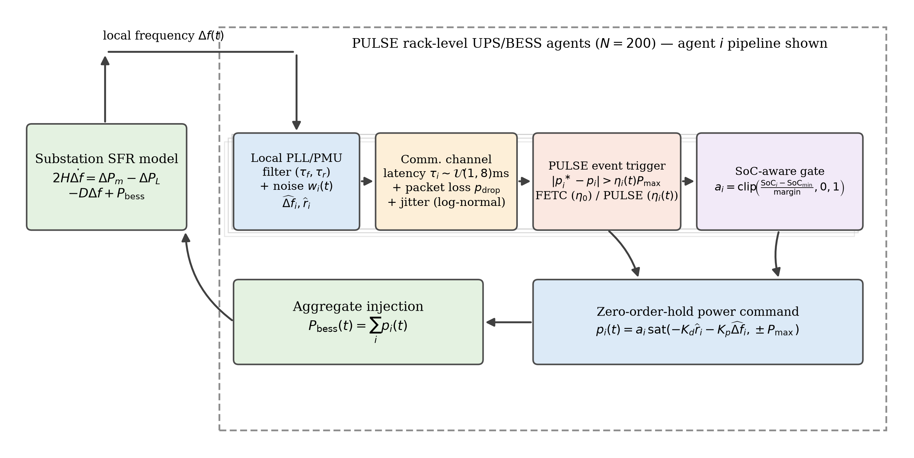

# PULSE: Sub-Cycle Grid Inertia and Frequency Support from Data Centers

Official simulation and figure-generation repository for the paper:

> **PULSE: Sub-Cycle Grid Inertia and Frequency Support from Data Centers**  
> *Seyed Mahmoud Sajjadi Mohammadabadi*  
> Department of Computer Science and Engineering, University of Nevada, Reno

---

## Overview

**PULSE** (**P**rimary-frequency **U**PS **L**ocal **S**ub-cycle **E**vent-triggered control) is a decentralized, zero-communication adaptive event-triggered control framework that enables gigawatt-scale data center uninterruptible power supply (UPS) and rack-level battery energy storage system (BESS) fleets ($N=200$ units) to provide sub-cycle synthetic inertia and primary frequency regulation without a central dispatcher.



### Key Highlights
- **Sub-Cycle Synthetic Inertia**: Reaches $90\%$ of steady-state aggregate support power within $7.4\,\text{ms}$ ($<0.5$ cycles at $60\,\text{Hz}$) under local sensing, cutting post-contingency frequency nadir deviation by $54\%$ ($59.734\,\text{Hz}$ vs. $59.423\,\text{Hz}$ unsupported).
- **Adaptive Local Event Triggering (PULSE)**: Eliminates idle-state communication traffic and uses a purely local time-relaxing threshold $\eta_i(t)$ to cut post-contingency messaging by up to $16.1\%$ relative to fixed-threshold event-triggered control (FETC) at zero cost to frequency nadir.
- **Network Imperfection Resilience**: Maintains frequency nadir within $28\,\text{mHz}$ ($59.768 \to 59.740\,\text{Hz}$) under up to $30\%$ Bernoulli packet drops and log-normal latency jitter (capped at $50\,\text{ms}$) using a fire-and-forget zero-order-hold (ZOH) architecture.
- **Backup Reserve & SoC Protection**: Enforces an $80\%$ minimum state-of-charge ($\text{SoC}_{\min}$) floor with a $10\%$ linear taper to protect N+1 data center IT backup reliability, recovering $31\%$ of the unsupported frequency deviation using the $39.4\%$ remaining fleet capacity.
- **IEEE C37.118 P-Class PMU & PLL Filtering**: Evaluates explicit 1-cycle inverter PLL ($\tau_f=16.7\,\text{ms}, \tau_r=33.3\,\text{ms}$) and 2-cycle P-class PMU ($\tau_f=33.3\,\text{ms}, \tau_r=100\,\text{ms}$) low-pass filters under $\sigma_f=0.5\,\text{mHz}$ Gaussian noise and a $\pm 15\,\text{mHz}$ deadband, demonstrating smooth, non-saturating proportional-derivative operation ($K_d=4\,\text{MW}\cdot\text{s}$, $72.8\text{--}74.4\%$ peak fleet utilization, $59.75\,\text{Hz}$ nadir).

---

## Repository Structure

| File / Folder | Description |
| :--- | :--- |
| `sim.py` | Main Python simulation script reproducing all numerical experiments, parametric sweeps, battery degradation calculations, and Figures 2–6 (`fig1_response` to `fig5_pmu_gain`). |
| `fig_overview.py` | Script generating the architectural block diagram (`figs/fig0_overview.png`, `figs/fig0_overview.pdf`, and `figs/graphical_abstract.png`). |
| `results_summary.txt` | Machine-readable CSV-style log of all simulated metrics across baseline, threshold sensitivity, contingency sweep, packet loss, SoC gating, and PMU/PLL gain regimes. |
| `figs/` | High-resolution PNG and vector PDF figures generated by `sim.py` and `fig_overview.py`. |

---

## Reproducing the Results

### Requirements
- Python 3.9+
- `numpy`
- `matplotlib`

Install dependencies via:
```bash
pip install numpy matplotlib
```

### Running the Simulations
To regenerate the system overview diagram (`Figure 1` / `fig0_overview`):
```bash
python fig_overview.py
```

To run the full $50\,\mu\text{s}$ explicit-Euler time-domain simulations and regenerate all figures (`figs/fig1_response.png` through `figs/fig5_pmu_gain.png`) and `results_summary.txt`:
```bash
python sim.py
```

---

## Citation

If you use this code or build upon the PULSE framework in your research, please cite:

```bibtex
@article{sajjadi2026pulse,
  title   = {{PULSE}: Sub-Cycle Grid Inertia and Frequency Support from Data Centers},
  author  = {Sajjadi Mohammadabadi, Seyed Mahmoud},
  year    = {2026},
  url     = {https://github.com/mahmoudsajjadi/PULSE-DataCenter-UPS-Frequency-Support}
}
```
